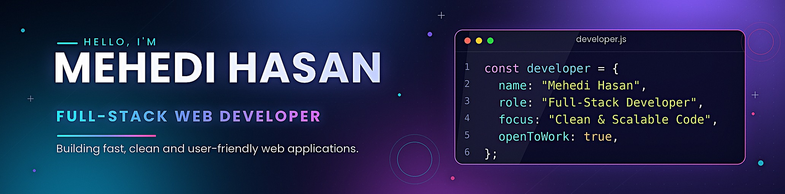

  

  React &nbsp;·&nbsp; Next.js &nbsp;·&nbsp; TypeScript &nbsp;·&nbsp; Node.js &nbsp;·&nbsp; MongoDB

  
  &nbsp;

  &nbsp;
  

---

---

---

<h2 align="center">About Me</h2>

  I'm a full-stack web developer who enjoys turning ideas into clean, responsive 
  and production-ready applications. I work across the whole stack, from building 
  interfaces with <b>React</b> and <b>Tailwind CSS</b> to creating secure REST APIs 
  with <b>Node.js</b>, <b>Express</b> and <b>MongoDB</b>.

<table>
  <tr>
    <td align="center" width="230">
       
      <b>Frontend Development</b> 
      Responsive, user-friendly interfaces with React, Next.js and Tailwind CSS
        
    </td>
    <td align="center" width="230">
       
      <b>Backend & APIs</b> 
      Secure REST APIs with Node.js, Express and MongoDB
        
    </td>
    <td align="center" width="230">
       
      <b>Type-Safe Code</b> 
      Clean, maintainable code written in TypeScript
        
    </td>
  </tr>
  <tr>
    <td align="center" width="230">
       
      <b>Authentication</b> 
      Login and protected routes using Better Auth
        
    </td>
    <td align="center" width="230">
       
      <b>Deployment</b> 
      Shipping and maintaining full-stack apps on modern platforms
        
    </td>
    <td align="center" width="230">
       
      <b>AI-Assisted Workflow</b> 
      Shipping faster without compromising quality
        
    </td>
  </tr>
</table>

   
  Comfortable with <b>Git & GitHub</b> workflows for solo and team projects.

---

<h2 align="center">🛠️ Tech Stack</h2>

<h4 align="center">Frontend</h4>

<table>
  <tr>
    <td align="center" width="95">
       <b>HTML5</b>
    </td>
    <td align="center" width="95">
       <b>CSS3</b>
    </td>
    <td align="center" width="95">
       <b>Tailwind</b>
    </td>
    <td align="center" width="95">
       <b>JavaScript</b>
    </td>
    <td align="center" width="95">
       <b>TypeScript</b>
    </td>
    <td align="center" width="95">
       <b>React</b>
    </td>
    <td align="center" width="95">
       <b>Next.js</b>
    </td>
  </tr>
</table>

<h4 align="center">Backend & Database</h4>

<table>
  <tr>
    <td align="center" width="95">
       <b>Node.js</b>
    </td>
    <td align="center" width="95">
       <b>Express.js</b>
    </td>
    <td align="center" width="95">
       <b>MongoDB</b>
    </td>
    <td align="center" width="95">
       <b>Mongoose</b>
    </td>
    <td align="center" width="95">
       <b>Better Auth</b>
    </td>
  </tr>
</table>

<h4 align="center">Tools</h4>

<table>
  <tr>
    <td align="center" width="95">
       <b>Git</b>
    </td>
    <td align="center" width="95">
       <b>GitHub</b>
    </td>
    <td align="center" width="95">
       <b>VS Code</b>
    </td>
    <td align="center" width="95">
       <b>Vercel</b>
    </td>
  </tr>
</table>

---

<h2 align="center">📫 Let's Connect</h2>

  <b>Open to full-stack & frontend developer opportunities, internships and freelance work.</b> 
  Have a project or a role in mind? I'd love to hear from you.

<table>
  <tr>
    <td align="center" width="230">
       
      
       
      <b>Email</b> 
      mehedi.hasan.bd.dev@gmail.com
        
      
    </td>
    <td align="center" width="230">
       
      
       
      <b>LinkedIn</b> 
      linkedin.com/in/mehedilabs
        
      
    </td>
  </tr>
</table>

   
  <i>Thanks for stopping by. Let's build something great together.</i>

